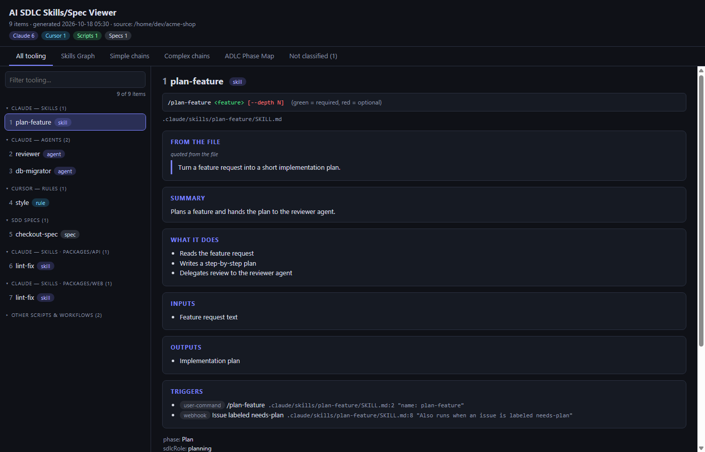
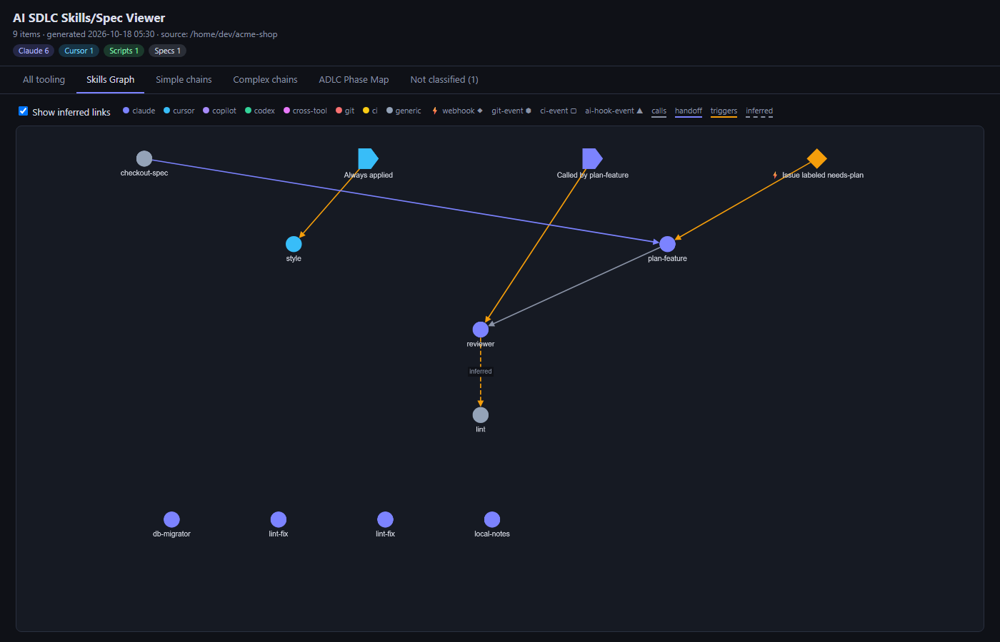

# AI SDLC Skills/Spec Viewer

An offline viewer for the AI tooling and specs in a repository. You run one skill in your AI coding tool. It scans the repo for skills, agents, hooks, MCP servers, rules, instructions, scripts, CI workflows and SDD specs, then writes a self-contained `ai-sdlc-viewer/` folder. Double-click `ai-sdlc-viewer/index.html` to browse it: no server, no network, no install.





The viewer lists every item with its ecosystem, invocation signature (green = required, red = optional), triggers and the evidence for each link, and draws how skills, agents, hooks and specs connect. Links are backed by a quoted line from a file; guesses are drawn dashed and labelled "inferred". Phase 2 (a Test Coverage tab) is planned.

## Install

The skill is one folder, `skills/ai-sdlc-viewer/`. Producing the output needs no Node or Python: the agent writes `data.js` and copies the viewer files.

### Claude Code (plugin)

```
/plugin marketplace add naveenckali/ai-sdlc-viewer
/plugin install ai-sdlc-viewer@ai-sdlc-viewer
```

### Any tool: installer

From a clone of https://github.com/naveenckali/ai-sdlc-viewer:

```sh
install/install.sh --tool <claude|copilot|copilot-cli|cursor|codex>             # user level
install/install.sh --tool <tool> --project /path/to/repo                         # per-repo fallback
```

PowerShell: `install/install.ps1 -Tool <tool> [-Project <repo>]`. Each tool also loads the skill from these folders:

| Tool | User-level dir | Project-level dir | Invoke |
|---|---|---|---|
| Claude Code (smoke test passed) | `~/.claude/skills/ai-sdlc-viewer/` | `.claude/skills/ai-sdlc-viewer/` | `/ai-sdlc-viewer:ai-sdlc-viewer` (plugin) or `/ai-sdlc-viewer` (skills folder) |
| Copilot CLI (smoke test failed: after a refused copy it tried other ways, wrote and ran a `.bat`, and delegated to a sub-agent that invented descriptions; see docs/tool-support.md) | `~/.copilot/skills/ai-sdlc-viewer/` | `.github/skills/ai-sdlc-viewer/` | `/ai-sdlc-viewer` |
| Copilot in VS Code (not yet verified) | `~/.copilot/skills/ai-sdlc-viewer/` | `.github/skills/ai-sdlc-viewer/` | `/ai-sdlc-viewer` in chat |
| Cursor (not yet verified) | `~/.cursor/skills/ai-sdlc-viewer/` | `.cursor/skills/ai-sdlc-viewer/` | `/` in Agent chat, pick `ai-sdlc-viewer` |
| Codex (smoke test passed) | `~/.agents/skills/ai-sdlc-viewer/` | `.agents/skills/ai-sdlc-viewer/` | `$ai-sdlc-viewer` or `/skills` |

The per-repo fallback copies the skill into the repo being scanned. The copy carries a `.ai-sdlc-viewer-plugin` marker, so the scan never reports it as part of your repo; you may still want to commit or ignore it. See [docs/tool-support.md](docs/tool-support.md) for sources and for which tools have been smoke-tested (Claude Code: pass. Codex: pass. Copilot CLI: failed, 7 of 76 checks, see "Cross-tool smoke tests" in that file. Cursor and Copilot in VS Code: `not yet verified`).

## Usage

Open your repo in the AI tool and invoke the skill: `/ai-sdlc-viewer:ai-sdlc-viewer` for the Claude Code plugin, `/ai-sdlc-viewer` for a skills-folder install, or the invocation in the table above. When it finishes, open `<repo>/ai-sdlc-viewer/index.html` by double-clicking it.

Some tools refuse the agent's `cp` of the viewer files (headless Claude Code does when the skill is a loaded plugin). The skill then stops, still writes `data.js`, and prints the exact copy commands for you to run.

## Output folder

The output is `<repo>/ai-sdlc-viewer/` (`index.html`, `data.js`, `viewer.css`, `app.js`, `lib/`, `vendor/`). Every run overwrites those files in place; the scan never deletes anything, and stops to ask if the folder holds other files. The scan is read-only toward your repo apart from this folder. You choose whether to commit it (shareable with the team) or add `ai-sdlc-viewer/` to `.gitignore`.

**Review the output folder before committing it.** Secrets are replaced with `[redacted]`, but redaction is best-effort and pattern-based. The folder can include excerpts of local-only files (for example a gitignored `.claude/settings.local.json`), which the viewer marks as local-only.

## Supplying your ADLC phases

By default the phase view is a placeholder. To map items to your own AI development lifecycle, add `.ai-sdlc-viewer/phases.json` to the repo and re-run the skill:

```json
{
  "source": "repo",
  "list": [
    { "id": "plan", "name": "Plan", "description": "Write the spec" },
    { "id": "build", "name": "Build", "description": "Implement with agents" }
  ]
}
```

Each entry needs a string `id` and `name`; `description` is optional. Items are assigned a phase only when their role clearly fits.

## Development

Node is needed only for development and tests.

```sh
npm install
npm test                                          # unit tests
node tools/run-e2e.js run1                        # end-to-end eval with Claude Code (plugin path)
node tools/run-e2e.js run1 --tool codex           # or --tool copilot-cli
node tools/make-fixture.js /tmp/fx                # build the fixture repo by hand
node tools/check-scan.js /tmp/fx tests/fixtures/sample-repo.expected.json
```

The e2e runs use your own tool account and quota. They install the skill into a throwaway fixture copy at project level and never use a blanket permission-bypass flag.

## License

`package.json` and the plugin manifest declare ISC, but no LICENSE file is included yet; the license is the project owner's choice.
